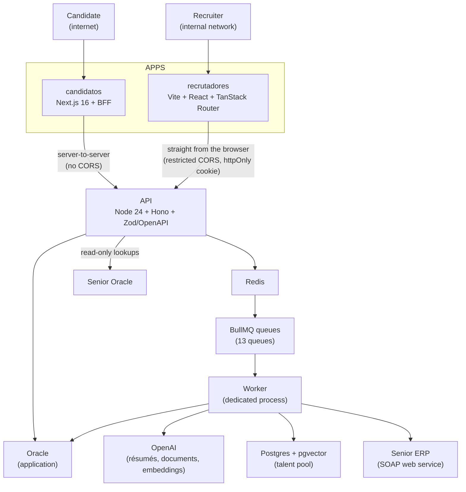

## About the Project

**Kontrata** is an **end-to-end ATS (Applicant Tracking System)** for Grupo Koch. It covers the whole hiring process: it starts at **job posting**, goes through the application funnel, AI résumé analysis, tests, interviews and background checks, and ends at the **final step: onboarding the new hire into Senior ERP**, with no data re-typing by HR.

The system is a **pnpm monorepo** with four main pieces:

- **API** — Node 24 + Hono + Zod/OpenAPI, with the contract generated from the routes themselves.
- **Candidate portal** — Next.js 16 (App Router), exposed to the internet.
- **Recruiter portal** — Vite + React 19 + TanStack Router SPA, restricted to the internal network.
- **Queue system** — BullMQ + Redis, consumed by a dedicated worker process.

> 🚧 **Project in staging.** Kontrata is still in a staging environment and is being tested with HR. It is not in production yet.

> ⚠️ **Internal project — no public link.** Because it handles candidate data, corporate integrations and the company ERP, **there is no public URL or open repository**. This post describes the **architecture and key decisions** in an anonymized way, without exposing endpoints, credentials or database schema.

## The Problem

The recruiting process relied on third-party services and manual steps between them:

- **Two paid tools.** Job posting and the candidate funnel lived in **Recrut.ai**, and the admission/documents step went through **Senior's Collab**. That's two recurring costs, each with its own records and data.
- **Siloed data.** What the candidate filled in on one system was re-typed into another until it reached the ERP.
- **Slow screening.** Reading résumés, matching them against job requirements and checking backgrounds took hours of the HR team's time.

> 💸 **Cost reduction.** Kontrata **eliminates these two internal third-party costs**. Once the project goes to production, **Recrut.ai and Senior's Collab will be cut**.

## Architecture

### The four apps

- **API.** One folder per route (`route.ts`, `handler.ts`, `schema.ts`, `service.ts`), split by audience: `candidates/` and `recruiters/`. There is a single error envelope, and the generated OpenAPI becomes the `@sistema/api-types` package consumed by both front-ends, which prevents contract _drift_.
- **Candidates.** The portal never talks to the API directly: it goes through a **BFF** (Next Route Handlers), with the token in an httpOnly cookie. Candidates browse jobs, apply, maintain their profile and résumé, take the behavioral profile test (DISC) and exams, upload documents and fill in the admission form.
- **Recruiters.** An SPA with a per-job stage board, interview calendar, chat with candidates, dashboard, talent pool, configurable stage flows and the Senior integrations screen. Login uses **Active Directory**, with authorization by feature and branch/stage scope.
- **Queues.** Anything slow, paid or unreliable leaves the request cycle and goes to BullMQ.

### Screens

## The Queue System

There are **13 queues**, each with its own retry, backoff and retention policy. All of them run in a single worker process, so there is only one service to operate. Among them:

- **Résumé analysis** — extracts and matches the résumé against the job criteria using OpenAI, with a 2-minute _debounce_ for re-analyses triggered by profile edits.
- **Criterion re-evaluation**, **history summary** and **process analysis** — asynchronous analyses that update the candidate card.
- **Talent pool** — job vectors in Postgres + pgvector (similarity index), with a suggestion queue and reconcile queues that repair possible failures.
- **Automatic verification** — background checks through an external service.
- **Job deadline** and **employment status** — scheduled jobs.
- **Senior integration** — sends the admission to the ERP.

Queues that call OpenAI have a **cap of 20 jobs per minute** to control cost. Each processing status reaches the screen via **SSE** (queue position and completion), with no polling.

## Final Step: Admission into Senior ERP

Once approved, the candidate fills in the admission form and uploads documents in the portal itself. A **block-based checklist** shows what's still missing. When the package is complete, the recruiter triggers the integration:

- The admission package is built and sent to Senior's Personnel Administration module through a **SOAP web service**: basic record, complementary record and dependents.
- The queue runs with **concurrency 1**, because the employee registration number is sequential and the ERP is slow. On failure there are **4 attempts with 30-second exponential backoff**.
- Every call is recorded in an integration log, visible on the recruiter's integrations screen.

Positions, branches and departments also come from Senior through **read-only queries** to a separate database, so HR never types ERP codes by hand.

## Key Challenges

- **Two audiences, two security surfaces.** The candidate is on the internet and the recruiter on the internal network. That's why paths, authentication (own JWT with revocable session _versus_ AD JWT in an httpOnly cookie) and CORS are separated by construction.
- **AI with controlled cost and failure.** Paid calls go through queues, with a window limiter, retries and periodic reconciliation. A terminal failure is retained for 24 hours so the UI can show the error.
- **Slow, sequential integration.** Respecting Senior's pace (one at a time, with backoff) is more reliable than parallelizing.
- **A single contract between API and front-ends.** The generated OpenAPI and shared packages (`ui`, `validators`, `api-client`) avoid duplicating types and rules.
- **Optional integrations.** Senior, OpenAI and the vector database may be absent: only the corresponding feature answers 503 and the system stays up, which makes running locally possible without a VPN.

## Technologies Used

- **TypeScript** + **Node 24** (direct execution, no build) + **Hono** + **Zod/OpenAPI** — end-to-end typed API.
- **Next.js 16** (App Router) — candidate portal with a BFF.
- **Vite** + **React 19** + **TanStack Router** — recruiter SPA.
- **Tailwind CSS** + a shared design system in the monorepo.
- **OracleDB** — application database; Senior Oracle in read-only mode.
- **Redis + BullMQ** — queues, rate limiting and workers.
- **PostgreSQL + pgvector** — vector search for the talent pool.
- **OpenAI** — résumé and document extraction, analyses and embeddings.
- **Docker** — Compose in development and Swarm + Traefik deployment.

## Technical Notes

- **In staging.** The design is stable, but the Senior integration is still being validated in a test environment before going to production.
- **Replaces, doesn't complement.** The goal is to switch off Recrut.ai and Senior's Collab, centralizing the entire process in an in-house system.
- **Anonymization.** Endpoints, credentials, hosts, table names and candidate data were deliberately omitted. The focus is the engineering.
