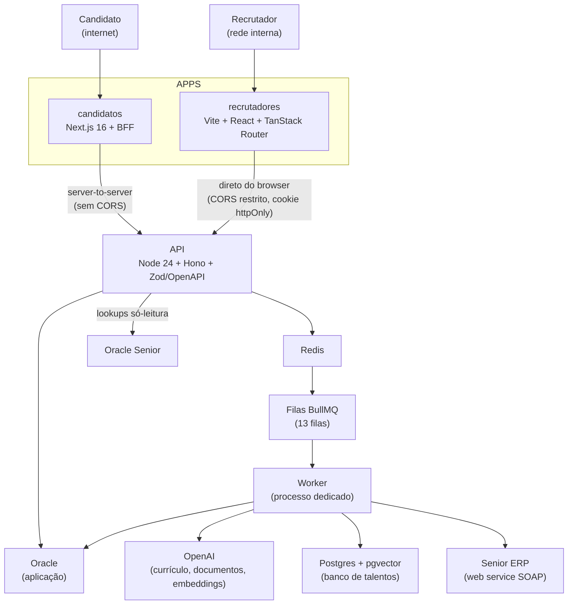

## Sobre o Projeto

**Kontrata** é um **ATS (Applicant Tracking System) de ponta a ponta** do Grupo Koch. Ele cobre o processo seletivo inteiro: começa na **divulgação das vagas**, passa pelo funil de candidaturas, pela análise de currículo com IA, pelas provas, entrevistas e verificações, e termina na **última etapa: a integração do novo colaborador no Senior ERP**, sem redigitação de dados pelo RH.

O sistema é um **monorepo pnpm** com quatro peças principais:

- **API** — Node 24 + Hono + Zod/OpenAPI, com o contrato gerado das próprias rotas.
- **Portal dos candidatos** — Next.js 16 (App Router), aberto na internet.
- **Portal dos recrutadores** — SPA Vite + React 19 + TanStack Router, restrita à rede interna.
- **Sistema de filas** — BullMQ + Redis, consumido por um processo worker dedicado.

> 🚧 **Projeto em homologação.** O Kontrata ainda está em ambiente de homologação e passa por testes com o RH. Ele ainda não está em produção.

> ⚠️ **Projeto interno, sem link público.** Por lidar com dados de candidatos, integrações corporativas e o ERP da empresa, **não há URL pública nem repositório aberto**. Este post descreve a **arquitetura e as principais decisões** de forma anonimizada, sem expor endpoints, credenciais ou schema de banco.

## O Problema

O processo de recrutamento dependia de serviços de terceiros e de passos manuais entre eles:

- **Duas ferramentas pagas.** A divulgação e o funil de candidatos ficavam no **Recrut.ai**, e a etapa de admissão/documentos passava pelo **Collab da Senior**. Eram dois custos recorrentes, cada um com seu cadastro e seus dados.
- **Dados em silos.** O que o candidato preenchia em um sistema era redigitado em outro até chegar ao ERP.
- **Triagem lenta.** Ler currículos, comparar com os requisitos da vaga e verificar antecedentes consumia horas do time de RH.

> 💸 **Corte de custos.** O Kontrata **elimina esses dois custos internos com terceiros**. Quando o projeto entrar em produção, **o Recrut.ai e o Collab da Senior serão cortados**.

## Arquitetura

### Os quatro apps

- **API.** Uma pasta por rota (`route.ts`, `handler.ts`, `schema.ts`, `service.ts`), separada por público: `candidates/` e `recruiters/`. O envelope de erro é único e o OpenAPI gerado vira o pacote `@sistema/api-types`, consumido pelos dois front-ends. Isso evita _drift_ de contrato.
- **Candidatos.** O portal nunca fala direto com a API: passa por um **BFF** (Route Handlers do Next), com token em cookie httpOnly. O candidato vê as vagas, se candidata, mantém perfil e currículo, faz o teste de perfil comportamental (DISC) e provas, envia documentos e preenche a admissão.
- **Recrutadores.** SPA com quadro (board) de etapas por vaga, agenda de entrevistas, chat com candidatos, dashboard, banco de talentos, fluxos de etapas configuráveis e a tela de integrações com a Senior. O login usa o **Active Directory**, com autorização por funcionalidade e escopo de filial/etapa.
- **Filas.** Tudo o que é lento, pago ou instável sai do ciclo de requisição e vai para o BullMQ.

### Telas

## O Sistema de Filas

Existem **13 filas** com política própria de retry, backoff e retenção. Todas ficam em um único processo worker, para operar um serviço só. Entre elas:

- **Análise de currículo** — extrai e compara o currículo com os critérios da vaga usando a OpenAI, com _debounce_ de 2 minutos para reanálises disparadas por edição de perfil.
- **Reavaliação de critérios**, **resumo do histórico** e **análise de processo** — análises assíncronas que atualizam o card do candidato.
- **Banco de talentos** — vetores das vagas em Postgres + pgvector (índice por similaridade), com fila de sugestão e filas de reconciliação para corrigir eventuais falhas.
- **Verificação automática** — consulta de antecedentes por meio de serviço externo.
- **Prazo de vagas** e **situação de vínculo** — jobs agendados.
- **Integração com a Senior** — envia a admissão ao ERP.

As filas que chamam a OpenAI têm um **teto de 20 jobs por minuto**, para controlar custo. O status de cada processamento chega à tela por **SSE** (posição na fila e conclusão), sem polling.

## Última Etapa: Admissão no Senior ERP

Depois de aprovado, o candidato preenche o formulário de admissão e envia seus documentos no próprio portal. Um **checklist por blocos** mostra o que ainda falta. Quando o pacote está completo, o recrutador dispara a integração:

- O pacote de admissão é montado e enviado ao módulo de Administração de Pessoal da Senior via **web service SOAP**: ficha básica, ficha complementar e dependentes.
- A fila roda com **concorrência 1**, porque o número de cadastro do colaborador é sequencial e o ERP é lento. Em caso de falha são **4 tentativas com backoff exponencial** de 30 segundos.
- Cada chamada é registrada em um log de integração, visível na tela de integrações do recrutador.

Cargos, filiais e setores também vêm da Senior, por **consultas só-leitura** em um banco separado, de modo que o RH nunca digita códigos de ERP à mão.

## Principais Dificuldades

- **Dois públicos, duas superfícies de segurança.** O candidato fica na internet e o recrutador na rede interna. Por isso os caminhos, a autenticação (JWT próprio com sessão revogável _versus_ JWT do AD em cookie httpOnly) e o CORS são separados por construção.
- **IA com custo e falha controlados.** Chamadas pagas ficam em fila, com limitador por janela, retries e reconciliação periódica. Uma falha terminal é retida por 24 horas para a tela exibir o erro.
- **Integração lenta e sequencial.** Respeitar o ritmo da Senior (um por vez, com backoff) é mais confiável do que paralelizar.
- **Contrato único entre API e front-ends.** O OpenAPI gerado e os pacotes compartilhados (`ui`, `validators`, `api-client`) evitam duplicar tipos e regras.
- **Integrações opcionais.** Senior, OpenAI e o banco vetorial podem estar ausentes: só a funcionalidade correspondente responde 503 e o sistema segue de pé, o que permite rodar localmente sem VPN.

## Tecnologias Utilizadas

- **TypeScript** + **Node 24** (execução direta, sem build) + **Hono** + **Zod/OpenAPI** — API tipada de ponta a ponta.
- **Next.js 16** (App Router) — portal dos candidatos com BFF.
- **Vite** + **React 19** + **TanStack Router** — SPA dos recrutadores.
- **Tailwind CSS** + design system compartilhado em monorepo.
- **OracleDB** — banco da aplicação; Oracle Senior em modo só-leitura.
- **Redis + BullMQ** — filas, rate limit e workers.
- **PostgreSQL + pgvector** — busca vetorial do banco de talentos.
- **OpenAI** — extração de currículo e documentos, análises e embeddings.
- **Docker** — Compose em desenvolvimento e deploy em Swarm com Traefik.

## Notas Técnicas

- **Em homologação.** O desenho está estável, mas a integração com a Senior ainda passa por validação em ambiente de testes antes de ir para produção.
- **Substitui, não complementa.** O objetivo é desligar o Recrut.ai e o Collab da Senior, centralizando o processo inteiro em um sistema próprio.
- **Anonimização.** Endpoints, credenciais, hosts, nomes de tabelas e dados de candidatos foram deliberadamente omitidos. O foco é a engenharia.
