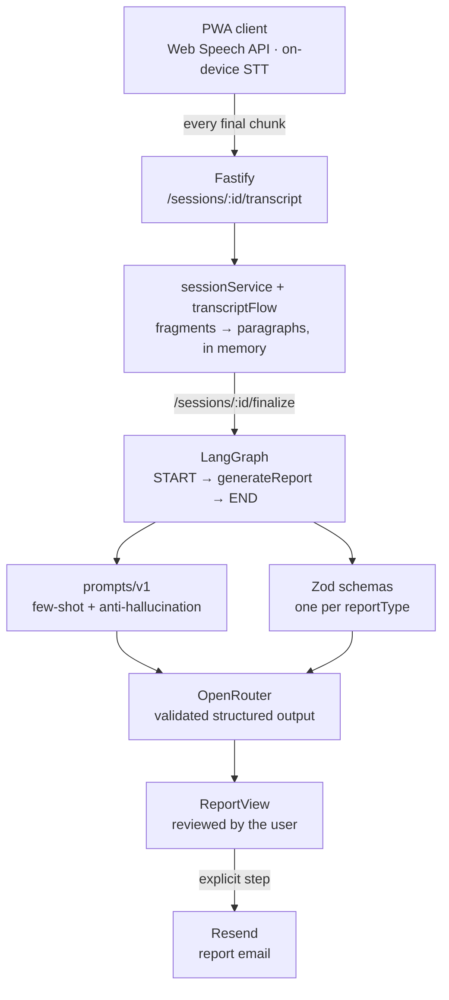

## About the Project

**Meeting Voice Reports** is a full-stack application that listens to meetings, interviews, and scheduling calls **in real time** and, when the session ends, produces a **structured report** — participants, agenda, decisions, action items with owner and deadline — ready to be reviewed and emailed.

The premise that defines the project is simple: **it is not a voice assistant**. There is no spoken reply and no turn-taking. The app only listens and transcribes live; the LLM enters at a single point, when the session is finalized, to turn the accumulated transcript into a schema-validated object. That constraint is what keeps the cost near zero for the entire meeting — speech recognition runs **100% in the browser** through the native Web Speech API, with no audio leaving the device and no per-minute STT billing.

## The Problem

Every meeting produces two things: the conversation, and the minutes nobody wants to write. Anyone trying to solve that with transcription tools runs into three costs:

- **Per-minute STT cost.** Speech-to-text services bill by audio duration. A team with several meetings a day turns that into a fixed cost line — and the audio has to leave the device to be processed.
- **A transcript is not a report.** A wall of transcribed text answers neither "what was decided" nor "who owns what". Someone still has to read all of it and pull the information out.
- **Hallucination in free-form text.** Asking an LLM to "summarize the meeting" in free form produces decisions nobody made and deadlines nobody agreed to. A meeting report is only useful if it is **faithful to what was actually said**.

The project's goal is to attack all three: free client-side STT, schema-driven structured extraction at close, and prompts with explicit anti-hallucination rules per session type.

## Architecture

The flow is deliberately asymmetric: **during** the session the backend is just a text accumulator; **at close** it becomes an extraction pipeline. That separation is what allows recording an hour-long meeting with a single LLM call.

## In-Browser Transcription

All speech recognition lives in the `useSpeechSession` hook, which wraps `window.SpeechRecognition ?? window.webkitSpeechRecognition`. Every **final** result is sent to the backend immediately; **interim** results only update local state (they show in italics, continuing the last paragraph, because they are the same sentence still being recognized).

Three decisions define the hook's behavior:

- **Stopping never erases.** `stop()` only ends capture and sets the status to `'stopped'` — that's what allows resuming where you left off, or generating the report after having stopped. Clearing happens exclusively through `reset()`, called by `App` when the user discards the recording or starts another session. An effect that reset itself upon seeing a different `sessionId` was removed: it erased speech out from under the user.
- **Estimated time stamping.** The Web Speech API doesn't report the duration of a recognized chunk. `stampChunk()` uses the result's arrival time as the end (reliable) and estimates the start from the text length (`CHARS_PER_SECOND`). That difference is what later becomes a paragraph break.
- **Screen wake lock.** Without it, the phone screen goes dark during the meeting and capture dies with it.

## From Fragment to Paragraph

The Web Speech API returns speech chopped up and unpunctuated: `"ok"`, `"keep recording"`, `"so we'll close it like that"`. Joining those chunks with line breaks hands the LLM a **list of fragments**, while the prompts' few-shot examples use flowing prose — the mismatch degraded extraction.

`buildFlowingTranscript`/`groupIntoParagraphs` (pure functions) fix that: they splice chunks with a space, complete missing punctuation, and only open a new paragraph after **3 seconds of silence** (`PARAGRAPH_GAP_MS`) or a speaker change. The degradation is safe: with no time stamping, the difference is zero and everything falls into a single paragraph — the acceptable worst case, never the old list.

The same module is mirrored in the frontend (`web/src/lib/transcriptFlow.ts`) so the transcript panel displays exactly the grouping the backend will send to the model. The two change together.

## Report Generation

On `finalize`, a **LangGraph** `StateGraph` runs a single linear node (`START → generateReport → END`). The node:

1. Looks up the matching Zod schema in `reportSchemaFor[reportType]`.
2. Builds the system and user prompts via `prompts/v1/buildGenerateReportPrompt`, which dispatches by session type.
3. Calls the LLM through `OpenRouterService`, which uses `createAgent` + `providerStrategy(schema)` from the `langchain` package to **force structured output validated by the schema**.

There are three session types, each with its own schema and prompt:

| Type           | What the schema extracts                                                                                                                                   |
| -------------- | ---------------------------------------------------------------------------------------------------------------------------------------------------------- |
| **Meeting**    | title, date, participants, agenda, discussion summary, decisions, action items (task + owner + deadline), open items                                       |
| **Interview**  | candidate, role, interviewers, question/answer pairs, strengths, weaknesses, overall assessment, recommendation (`avancar` / `reprovar` / `proxima_etapa`) |
| **Scheduling** | event type, date/time, participants, location, open points of the arrangement                                                                              |

The anti-hallucination rules live in the schema itself, through `.describe()`: _"only decisions actually closed by the group — not suggestions or open ideas"_, _"deadline exactly as mentioned in the conversation; `null` if no deadline was stated"_, _"`avancar` only if an interviewer expressed clear intent to approve"_. The description travels with the JSON Schema to the model — it is instruction and contract at the same time.

Adding a new report type is a three-file operation: a new schema in `schemas/`, an entry in `REPORT_TYPES`/`reportSchemaFor`, and the matching module in `prompts/v1/`.

## Email Delivery

Email does **not** go out automatically on `finalize`. It's a step of its own, after the report has been reviewed, where the user provides the recipients — and it can be skipped. `EmailDelivery` accepts multiple comma-separated addresses that turn into removable chips, and validation only appears **after the first send attempt** (flagging an error while someone is still typing their first address is noise).

On the backend, `composeRecipients` is a pure function that merges the requested recipients with `REPORT_EMAIL_TO` — always included as an archive copy — deduplicating case-insensitively. The template (`buildReportEmailHtml`) renders the generic `report.data` into an HTML table **with content escaping**: the text comes from an LLM and from a transcript, and is treated as untrusted.

## Key Challenges

- **Exclusive microphone access on mobile.** Android and iOS grant exclusive microphone access: keeping the level meter's `MediaStream` open **prevented recognition from capturing anything at all**. The fix was stopping the `getUserMedia` tracks before `recognition.start()` and restricting the meter to desktop (`supportsLevelMeter()`). On mobile the `AudioVisualizer` draws a pulsing orb driven by `isCapturingSpeech` instead of a waveform — and the caption talks about speech activity, not capture quality: promising "capturing well" without measuring would be a lie.
- **Infinite restart loop.** The Web Speech API's `onend` fires on its own during prolonged silence. Restarting directly in the handler, as the first version did, became an infinite loop and **froze the tab** when the microphone was unavailable. Today restarts go through `scheduleRestart()` with exponential backoff (300ms → 5s) and a ceiling of 8 consecutive attempts, reset on `onaudiostart` — the signal that capture actually began, since periodic termination during silence is normal and must not consume the ceiling.
- **`audio-capture` is recoverable, not fatal.** On Android the device may not have been released yet between the tracks' `stop()` and `recognition.start()`. Treating that error as fatal killed the session inside a millisecond-wide window; that window is exactly what the backoff covers. Once attempts are exhausted, a specific "microphone busy" message replaces the generic one.
- **Double taps creating orphan streams.** A double tap on the button during the microphone detection `await` opened a **second** `MediaStream` and a second meter loop, both orphaned. A reentrancy guard (`startingSessionRef`) closes that hole.
- **An installed PWA on iOS has no Web Speech API.** Installed to the iOS home screen, the app simply doesn't recognize speech (as a browser tab it works normally, on any platform). The manifest is built to avoid that mode, and for anyone who already installed it that way the app detects the case and offers an "Open in Safari" link — which has to be a real anchor with `target="_blank"` for iOS to escape standalone mode.
- **Fail loudly, not silently.** The microphone is only released in a secure context: `http://` on a local network IP **never** works. `micSupport.ts` centralizes detection (insecure context, missing `mediaDevices`, missing Web Speech API, no `audioinput`, denied permission) and translates each case into an actionable message. The "Check again" button only appears for blocks that can change without leaving the page — a button that can never succeed is worse than no button.
- **Strict JSON schema and the forbidden `.optional()`.** Models routed through providers that require strict JSON Schema (Azure, for instance) require **every** field in `properties` to also be in `required`. That's why optional fields in the Zod schemas are `z.string().nullable()`, never `.optional()` — one forgotten `.optional()` brings down the entire call, depending on where OpenRouter routes.
- **Sequential IDs colliding across processes.** Session and report IDs used to be an in-memory counter. Since it restarts with the process, two different reports in different processes ended up with the same id `"1"` — colliding on Resend's idempotency key and making the second email vanish. Everything is `crypto.randomUUID()` now.
- **Timer versus transcript.** The `Recorder` is mounted with `key={session.id}`: remounting per session is what resets the recording timer. It does **not** reset the transcript, which lives in the hook — the separation is intentional, because pausing and resuming must neither restart the clock nor erase the speech.

## Technologies Used

- **Node.js / TypeScript** — backend running native TypeScript, no bundler.
- **Fastify** — four routes (`/sessions`, `/sessions/:id/transcript`, `/sessions/:id/finalize`, `/reports/:id/email`), with injectable `ServerDeps` for testing.
- **LangChain.js + LangGraph** — a single-node `StateGraph` and `createAgent` + `providerStrategy` for structured output.
- **OpenRouter** — model routing through a custom `baseURL` on `ChatOpenAI`; optional tracing via LangSmith.
- **Zod** — one schema per report type, plus validation of every backend response in the HTTP client (`safeParse`).
- **React 19 + Vite + PWA** — single screen with a four-step stepper, Radix UI, Motion, and `sonner` for toasts.
- **Web Speech API** — native browser STT, running on the device.
- **Resend** — report delivery, with a plain HTML template and content escaping.
- **Deploy** — backend on Render (`render.yaml` blueprint), frontend on Netlify (`web/netlify.toml`).
- **Testing** — `node --test` (native runner), with separate unit and e2e suites on the backend.

## Technical Notes

- **The LLM runs exactly once.** The whole architecture exists to guarantee that: transcribing is free and local, extracting is expensive and one-off. Any feature requiring an LLM during recording would break the project's cost model.
- **Pure functions wherever possible.** `transcriptFlow`, `composeRecipients`, `buildReportEmailHtml`/`buildReportEmailSubject`, and recipient parsing are all pure — that's what lets the unit test suite cover the real logic without calling any API. The e2e tests stay isolated and only run with a real key.
- **In-memory persistence, by decision.** Sessions and reports live in `Map`s; restarting the backend wipes everything. It fits the scope (a session lives for minutes, not days), but it's the first limitation to fall if the project grows.
- **Resend sandbox.** The default `onboarding@resend.dev` sender only delivers to the account owner — sending to arbitrary recipients requires verifying a domain.
