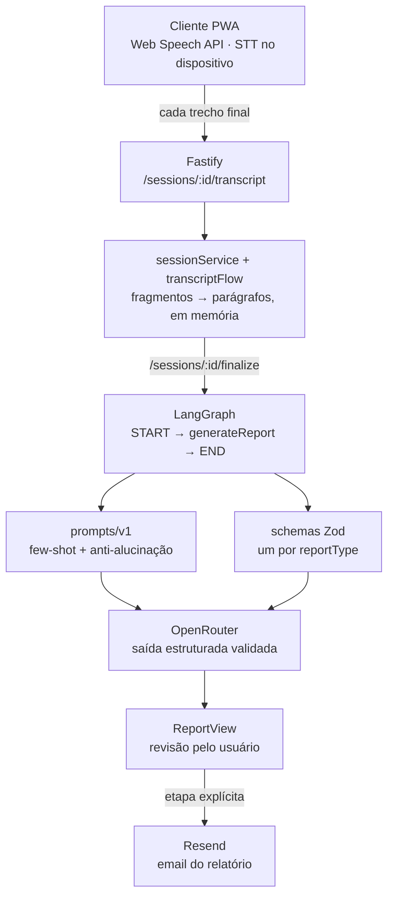

## Sobre o Projeto

**Meeting Voice Reports** é uma aplicação full-stack que ouve reuniões, entrevistas e agendamentos **em tempo real** e entrega, ao final da sessão, um **relatório estruturado** — participantes, pauta, decisões, itens de ação com responsável e prazo — pronto para ser revisado e enviado por email.

A premissa que define o projeto é simples: **não é um assistente de voz**. Não há resposta falada nem _turn-taking_. O app só escuta e transcreve ao vivo; o LLM entra em um único ponto, no fechamento da sessão, para transformar a transcrição acumulada em um objeto validado por schema. Essa restrição é o que mantém o custo próximo de zero durante a reunião inteira — o reconhecimento de fala roda **100% no navegador**, via Web Speech API nativa, sem áudio trafegando pela rede e sem cobrança por minuto de STT.

## O Problema

Toda reunião gera duas coisas: a conversa e a ata que ninguém quer escrever. Quem tenta resolver isso com ferramentas de transcrição esbarra em três custos:

- **Custo de STT por minuto.** Serviços de _speech-to-text_ cobram por duração de áudio. Uma equipe com várias reuniões diárias transforma isso numa linha fixa de custo — e o áudio precisa sair do dispositivo para ser processado.
- **Transcrição não é relatório.** Um bloco corrido de texto transcrito não responde "o que foi decidido" nem "quem ficou com o quê". Alguém ainda precisa ler tudo e extrair as informações.
- **Alucinação em texto solto.** Pedir a um LLM que "resuma a reunião" em formato livre produz decisões que ninguém tomou e prazos que ninguém combinou. Um relatório de reunião só é útil se for **fiel ao que foi dito**.

O objetivo do projeto é atacar os três: STT gratuito no cliente, extração estruturada por schema no fechamento, e prompts com regras anti-alucinação explícitas por tipo de sessão.

## Arquitetura

O fluxo é deliberadamente assimétrico: **durante** a sessão, o backend é só um acumulador de texto; **no fechamento**, ele vira um pipeline de extração. Essa separação é o que permite gravar uma reunião de uma hora com uma única chamada ao LLM.

## Transcrição no Navegador

Todo o reconhecimento de fala vive no hook `useSpeechSession`, que encapsula `window.SpeechRecognition ?? window.webkitSpeechRecognition`. Cada resultado **final** é enviado imediatamente ao backend; resultados **interinos** só atualizam o estado local (aparecem em itálico, continuando o último parágrafo, porque são a mesma frase ainda sendo reconhecida).

Três decisões definem o comportamento do hook:

- **Parar nunca apaga.** `stop()` só encerra a captura e coloca o status em `'stopped'` — é o que permite retomar de onde parou ou gerar o relatório depois de ter parado. Limpar é exclusivamente via `reset()`, chamado pelo `App` quando o usuário descarta a gravação ou inicia outra sessão. Um efeito que resetava sozinho ao ver um `sessionId` diferente foi removido: ele apagava a fala em cima do usuário.
- **Carimbo de tempo estimado.** A Web Speech API não informa a duração do trecho reconhecido. `stampChunk()` usa o instante de chegada do resultado como fim (confiável) e estima o início pelo tamanho do texto (`CHARS_PER_SECOND`). É essa diferença que, mais tarde, vira quebra de parágrafo.
- **Wake lock de tela.** Sem ele, a tela do celular apaga durante a reunião e a captura morre junto.

## Do Fragmento ao Parágrafo

A Web Speech API devolve a fala picada e sem pontuação: `"top"`, `"vai gravando"`, `"então a gente fecha assim"`. Juntar esses trechos com quebras de linha entrega ao LLM uma **lista de fragmentos**, enquanto os exemplos _few-shot_ dos prompts usam prosa corrida — a incompatibilidade degradava a extração.

`buildFlowingTranscript`/`groupIntoParagraphs` (funções puras) resolvem isso: emendam os trechos com espaço, completam a pontuação faltante e só abrem um parágrafo novo quando houve **3 segundos de silêncio** (`PARAGRAPH_GAP_MS`) ou o falante mudou. O degradê é seguro: sem marcação de tempo, a diferença dá zero e tudo cai num parágrafo único — o pior caso aceitável, nunca a lista de antes.

O mesmo módulo existe espelhado no frontend (`web/src/lib/transcriptFlow.ts`), para que o painel de transcrição exiba exatamente o agrupamento que o backend vai enviar ao modelo. Os dois mudam juntos.

## Geração do Relatório

No `finalize`, um `StateGraph` do **LangGraph** roda um único node linear (`START → generateReport → END`). O node:

1. Busca o schema Zod correspondente em `reportSchemaFor[reportType]`.
2. Monta system e user prompt via `prompts/v1/buildGenerateReportPrompt`, que despacha por tipo de sessão.
3. Chama o LLM através do `OpenRouterService`, que usa `createAgent` + `providerStrategy(schema)` do pacote `langchain` para **forçar saída estruturada validada pelo schema**.

São três tipos de sessão, cada um com schema e prompt próprios:

| Tipo            | O que o schema extrai                                                                                                                                             |
| --------------- | ----------------------------------------------------------------------------------------------------------------------------------------------------------------- |
| **Reunião**     | título, data, participantes, pauta, resumo da discussão, decisões, itens de ação (tarefa + responsável + prazo), pendências                                       |
| **Entrevista**  | candidato, vaga, entrevistadores, pares pergunta/resposta, pontos fortes, pontos fracos, avaliação geral, recomendação (`avancar` / `reprovar` / `proxima_etapa`) |
| **Agendamento** | tipo de evento, data/hora, participantes, local, pendências do combinado                                                                                          |

As regras anti-alucinação vivem no próprio schema, via `.describe()`: _"apenas decisões efetivamente fechadas pelo grupo — não sugestões ou ideias em aberto"_, _"prazo exatamente como mencionado na conversa; `null` se nenhum prazo foi dito"_, _"`avancar` só se um entrevistador expressou intenção clara de aprovar"_. A descrição vai junto com o JSON Schema para o modelo — é instrução e contrato ao mesmo tempo.

Adicionar um novo tipo de relatório é uma operação de três arquivos: novo schema em `schemas/`, entrada em `REPORT_TYPES`/`reportSchemaFor`, e o módulo correspondente em `prompts/v1/`.

## Envio por Email

O email **não** sai automaticamente no `finalize`. É uma etapa própria, depois da revisão do relatório, onde o usuário informa os destinatários — e que pode ser pulada. O `EmailDelivery` aceita vários endereços separados por vírgula, que viram chips removíveis, e a validação só aparece **depois da primeira tentativa de envio** (apontar erro enquanto a pessoa ainda digita o primeiro endereço é ruído).

No backend, `composeRecipients` é uma função pura que junta os destinatários pedidos com o `REPORT_EMAIL_TO` — que vai sempre como cópia de arquivo — deduplicando de forma _case-insensitive_. O template (`buildReportEmailHtml`) renderiza o `report.data` genérico numa tabela HTML **com escape de conteúdo**: o texto vem de LLM e de transcrição, e é tratado como não-confiável.

## Principais Dificuldades

- **Microfone exclusivo no mobile.** Android e iOS dão acesso exclusivo ao microfone: manter o `MediaStream` do medidor de nível aberto **impedia o reconhecimento de capturar qualquer coisa**. A solução foi parar as tracks do `getUserMedia` antes do `recognition.start()` e restringir o medidor ao desktop (`supportsLevelMeter()`). No mobile, o `AudioVisualizer` desenha um orbe pulsante ligado a `isCapturingSpeech` em vez de forma de onda — e a legenda fala de atividade de fala, não de qualidade de captação: prometer "captando bem" sem medir seria mentira.
- **Reinício em laço infinito.** O `onend` da Web Speech API dispara sozinho em silêncio prolongado. Reiniciar direto no handler, como era na primeira versão, virava laço infinito e **congelava a aba** quando o microfone estava indisponível. Hoje o restart passa por `scheduleRestart()` com backoff exponencial (300ms → 5s) e teto de 8 tentativas consecutivas, zerado em `onaudiostart` — o sinal de que a captura realmente começou, já que o encerramento periódico em silêncio é normal e não pode consumir o teto.
- **`audio-capture` é recuperável, não fatal.** No Android, o dispositivo pode ainda não ter sido liberado entre o `stop()` das tracks e o `recognition.start()`. Tratar esse erro como fatal matava a sessão numa janela de milissegundos; é exatamente essa janela que o backoff cobre. Esgotadas as tentativas, entra a mensagem específica de "microfone ocupado" no lugar da genérica.
- **Duplo-toque criando streams órfãos.** Um duplo-toque no botão durante o `await` da detecção de microfone abria um **segundo** `MediaStream` e um segundo loop de medidor, ambos órfãos. Uma guarda de reentrância (`startingSessionRef`) fecha esse buraco.
- **PWA instalado no iOS não tem Web Speech API.** Instalado na tela de início do iOS, o app simplesmente não reconhece fala (como aba de navegador funciona normalmente, em qualquer plataforma). O manifesto é montado para evitar esse modo, e para quem já instalou assim o app detecta o caso e oferece um link "Abrir no Safari" — que precisa ser âncora real com `target="_blank"` para o iOS escapar do modo standalone.
- **Falhar em voz alta, não em silêncio.** O microfone só é liberado em contexto seguro: `http://` em IP de rede local **nunca** funciona. `micSupport.ts` centraliza a detecção (contexto inseguro, ausência de `mediaDevices`, Web Speech API ausente, nenhum `audioinput`, permissão negada) e traduz cada caso em mensagem acionável em PT-BR. O botão "Verificar de novo" só aparece para bloqueios que podem mudar sem sair da página — um botão que nunca pode dar certo é pior que botão nenhum.
- **_Strict JSON schema_ e o `.optional()` proibido.** Modelos roteados via provedores que exigem JSON Schema estrito (Azure, por exemplo) exigem que **todo** campo em `properties` também esteja em `required`. Por isso campos opcionais nos schemas Zod são `z.string().nullable()`, nunca `.optional()` — um `.optional()` esquecido derruba a chamada inteira, dependendo de para onde a OpenRouter rotear.
- **IDs sequenciais colidindo entre processos.** Os IDs de sessão e relatório eram um contador em memória. Como ele reinicia junto com o processo, dois relatórios diferentes em processos diferentes pegavam o mesmo id `"1"` — e colidiam na _idempotency key_ do Resend, fazendo o segundo email sumir. Hoje tudo é `crypto.randomUUID()`.
- **Cronômetro versus transcript.** O `Recorder` é montado com `key={session.id}`: remontar por sessão é o que zera o cronômetro de gravação. Ele **não** zera o transcript, que mora no hook — a separação é intencional, porque pausar e continuar não pode reiniciar o relógio nem apagar a fala.

## Tecnologias Utilizadas

- **Node.js / TypeScript** — backend rodando TypeScript nativo, sem bundler.
- **Fastify** — quatro rotas (`/sessions`, `/sessions/:id/transcript`, `/sessions/:id/finalize`, `/reports/:id/email`), com `ServerDeps` injetáveis para testes.
- **LangChain.js + LangGraph** — `StateGraph` de um node e `createAgent` + `providerStrategy` para saída estruturada.
- **OpenRouter** — roteamento de modelo via `baseURL` custom no `ChatOpenAI`; tracing opcional via LangSmith.
- **Zod** — um schema por tipo de relatório e validação de toda resposta do backend no client HTTP (`safeParse`).
- **React 19 + Vite + PWA** — tela única com stepper de quatro passos, Radix UI, Motion e `sonner` para toasts.
- **Web Speech API** — STT nativo do navegador, rodando no dispositivo.
- **Resend** — envio do relatório, com template HTML puro e escape de conteúdo.
- **Deploy** — backend em Render (blueprint `render.yaml`), frontend em Netlify (`web/netlify.toml`).
- **Testes** — `node --test` (runner nativo), com suítes unitárias e e2e separadas no backend.

## Notas Técnicas

- **O LLM entra uma vez só.** A arquitetura inteira existe para garantir isso: transcrever é grátis e local, extrair é caro e pontual. Qualquer feature que exigisse LLM durante a gravação quebraria o modelo de custo do projeto.
- **Funções puras onde dá.** `transcriptFlow`, `composeRecipients`, `buildReportEmailHtml`/`buildReportEmailSubject` e o parsing de destinatários são todos puros — é o que torna a suíte de testes unitários capaz de cobrir a lógica de verdade sem chamar API nenhuma. Os testes e2e ficam isolados e só rodam com chave real.
- **Persistência em memória, por decisão.** Sessões e relatórios vivem em `Map`; reiniciar o backend apaga tudo. É adequado ao escopo (uma sessão vive minutos, não dias), mas é a primeira limitação a cair se o projeto crescer.
- **Sandbox do Resend.** O remetente padrão `onboarding@resend.dev` só entrega para o dono da conta — enviar para qualquer destinatário exige verificar um domínio próprio.
